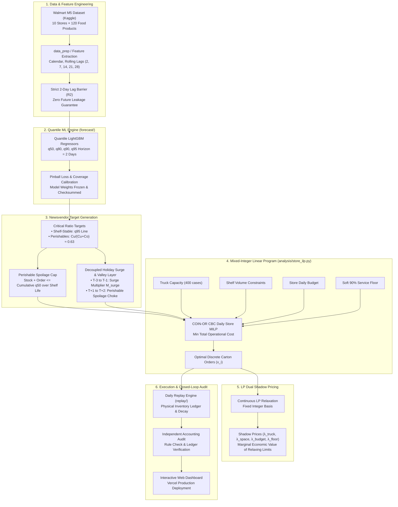

# ShelfWise: Autonomous Multi-Store Retail Replenishment & Inventory Optimization Engine

**CS2105: Optimization Techniques Course Project — Indian Institute of Technology Patna (IIT Patna), Semester III**

[](https://shelf-wise-stock-optimiser.vercel.app/)
[](https://www.iitp.ac.in/)
[](https://www.python.org/)
[](https://shelf-wise-stock-optimiser.vercel.app/)
[](https://github.com/coin-or/Cbc)
[](https://pytest.org/)

> 🚀 **Live Production Dashboard & What-If Simulation Suite:**  
> **[https://shelf-wise-stock-optimiser.vercel.app/](https://shelf-wise-stock-optimiser.vercel.app/)**
>
> 📊 **Official 12-Slide Final Presentation:**  
> Located at [`docs/ShelfWise_Final_Presentation.pptx`](docs/ShelfWise_Final_Presentation.pptx) and deep-dive technical monographs in [`docs/`](docs/).

---

## 📌 Executive Summary

Every morning, modern grocery retail chains face a multi-million-dollar dilemma across hundreds of stores:
- **Under-order**, and shelves go empty: customer demand is unserved, brand loyalty degrades, and high-margin sales are lost permanently.
- **Over-order**, and shelves overflow: working capital is locked in excess inventory, storage thresholds are breached, and perishable food spoils in backrooms.

**ShelfWise** is a production-grade, closed-loop daily inventory replenishment and supply chain optimization engine. Operating on the real-world **Walmart M5 benchmark dataset** (Kaggle), ShelfWise governs **10 retail superstores** across California, Texas, and Wisconsin over **120 high-velocity food products** (including 20 perishable fresh lines with dynamic shelf-life decay).

ShelfWise replaces naive inventory heuristics with a mathematically principled two-tier architecture:
1. **Asymmetric Quantile Machine Learning (`forecast/`):** A LightGBM gradient-boosted quantile regression engine predicting $q_{50}, q_{80}, q_{90}, q_{95}$ demand distributions under a strict 2-day informational lag barrier (zero data leakage).
2. **Constrained Mixed-Integer Linear Programming (`analysis/store_ilp.py`):** Daily store-level Mixed-Integer Linear Programs (MILP) solved via COIN-OR CBC that turn continuous Newsvendor critical ratios into discrete, whole-carton orders under physical truck capacities, volumetric shelf bounds, working capital limits, soft service floors, and perishable spoilage throttles.
3. **Exact Shadow Pricing via LP Dual Relaxation:** Re-solving the optimal integer commitments as a continuous Linear Program (LP) to extract exact dual shadow prices ($\lambda_{\text{truck}}, \lambda_{\text{space}}, \lambda_{\text{budget}}, \lambda_{\text{floor}}$), pinpointing the precise marginal economic value of expanding physical constraints.
4. **Decoupled Lead-Time Aware Holiday Policy:** A festival surge and post-holiday slump throttling layer that pre-builds inventory for holiday spikes while suppressing perishable spoilage by **80.6%** during post-holiday slumps without risking dry-good stockouts.

---

## 🏆 Key Benchmark Results

ShelfWise was evaluated through an 8-week test window and two strictly sealed holdout blocks (spanning 150+ simulated days) against classical retail heuristics:
- **`habit`**: Repeat same-day sales from last week.
- **`topup_avg`**: Top up to a 28-day rolling average with safety stock.
- **`topup_forecast`**: Point-forecast top-up policy.
- **`store_model`**: Unconstrained Newsvendor critical fractile orders.
- **`store_ilp` (ShelfWise)**: Discrete MILP carton allocation + LP dual shadow pricing.

### Performance Summary Across Evaluation Periods

| Evaluation Window | Timeframe | ShelfWise Fill Rate | Dumpster Waste (Units) | Net Cost + Lost Sales Penalty | Improvement vs Best Heuristic |
|:---|:---|:---:|:---:|:---:|:---:|
| **Test Window (Core ILP)** | 1 Nov 2015 – 26 Dec 2015 (8 wks) | **94.87%** | **8,043** | **$934,088** | **−7.7%** vs best simple rule |
| **Test Window (+ Layers)** | 1 Nov 2015 – 26 Dec 2015 (8 wks) | **94.96%** | **7,015** | **$932,094** | **−7.9%** vs best simple rule |
| **Sealed Holdout Block 1** | 27 Dec 2015 – 13 Feb 2016 (7 wks) | **94.14%** | **4,469** | **$855,095** | **−5.2%** vs best simple rule |
| **Sealed Holdout Block 2** | 14 Feb 2016 – 2 Apr 2016 (7 wks) | **95.40%** | **5,465** | **$887,087** | **−7.1%** vs best simple rule |
| **Sealed Holdout Block 3** | 3 Apr 2016 – 22 May 2016 (7 wks) | *Sealed* | *Sealed* | *Sealed* | *Virgin Holdout* |

### Why Naive Rules Fail
- Classical heuristics like `topup_avg` and `topup_forecast` achieve high availability (95–98%) only by drowning stores in excess stock, generating **35,000 to 70,800+ spoiled units** per block.
- ShelfWise slashes waste to **4,400–7,000 units** (an **80% to 90% reduction in food spoilage**) while sustaining a rock-solid **~95% service fill rate** and saving \$60,000–\$80,000+ per quarter.

---

## 🏗️ System Architecture & Workflow



---

## 📐 Mathematical Formulation

### 1. Newsvendor Target Calibration
For perishable products with unit underage cost $C_u$ (lost margin plus stockout penalty) and unit overage cost $C_o$ (purchase cost plus holding and disposal fees):
$$\text{Critical Fractile } \tau^* = \frac{C_u}{C_u + C_o} \approx 0.63$$
- **Perishable items**: Targeted between $q_{50}$ and $q_{80}$ according to $\tau^*$, bounded by a dynamic spoilage cap:
  $$\text{Stock}_{i,t} + x_i \cdot \text{pack}_i \le \sum_{k=0}^{\text{shelf\_life}_i - 1} \hat{q}_{50, i, t+k}$$
- **Non-perishable items**: Targeted directly to high-reliability service fractile $\hat{q}_{95, i, t}$.

### 2. Daily Store Mixed-Integer Linear Program (MILP)
Every morning, for each store $s$, ShelfWise solves:

$$\min \sum_{i} \left( c_i x_i \cdot \text{pack}_i + c_{\text{line}} y_i + h_i \cdot I_{i, t+1} + \pi_i \cdot \text{Shortfall}_i + \gamma_i \cdot \text{Waste}_i \right) + c_{\text{truck}} \cdot T$$

**Subject to:**
1. **Integer Carton Quantization:**
   $$x_i \in \mathbb{Z}_{\ge 0}, \quad x_i \le M \cdot y_i, \quad y_i \in \{0, 1\}$$
2. **Truck Capacity Limit:**
   $$\sum_{i} x_i \le C_{\text{truck}} \cdot T, \quad T \in \mathbb{Z}_{\ge 0} \quad (C_{\text{truck}} = 400 \text{ cartons})$$
3. **Volumetric Shelf-Space Limit:**
   $$\sum_{i} v_i \left( \text{Stock}_{i, t} + x_i \cdot \text{pack}_i \right) \le V_{\text{store}}$$
4. **Daily Procurement Budget:**
   $$\sum_{i} c_i x_i \cdot \text{pack}_i \le B_{\text{store}}$$
5. **Soft Service Floor (90% Guarantee):**
   $$\text{Stock}_{i, t} + x_i \cdot \text{pack}_i + \text{Slack}_{i} \ge 0.90 \cdot \text{Target}_{i, t}$$
6. **Perishable Spoilage Throttling:**
   $$\text{Stock}_{i, t} + x_i \cdot \text{pack}_i \le \text{Cap}_{i, t}^{\text{spoilage}}$$

### 3. LP Dual Relaxation & Shadow Pricing
After solving the MILP, the discrete decision variables $x_i$ and $T$ are fixed to their integer solutions, and the problem is re-solved as a continuous Linear Program:
$$\lambda_{\text{truck}} = \frac{\partial \text{Cost}^*}{\partial C_{\text{truck}}}, \quad \lambda_{\text{space}} = \frac{\partial \text{Cost}^*}{\partial V_{\text{store}}}, \quad \lambda_{\text{budget}} = \frac{\partial \text{Cost}^*}{\partial B_{\text{store}}}, \quad \lambda_{\text{floor}, i} = \frac{\partial \text{Cost}^*}{\partial \text{Floor}_i}$$
These dual multipliers quantify the exact dollar savings obtainable if warehouse trucks, shelf allocations, or working capital were expanded by one unit.

---

## 🌐 Interactive Web Dashboard

ShelfWise features a reactive web application deployed live on Vercel:

🔗 **[https://shelf-wise-stock-optimiser.vercel.app/](https://shelf-wise-stock-optimiser.vercel.app/)**

### Dashboard Pages & Features
1. **Executive Overview (`#/overview`):** High-level KPI tickers, side-by-side cost and fill comparisons across all 5 methods, and period selectors (Test Window, Holdout 1, Holdout 2).
2. **8-Week Workflow Calendar (`#/workflow`):** Interactive calendar heatmaps for each day of the 56-day replay, colored by daily fill rates, featuring event tags, Thanksgiving/Christmas alerts, and rolling automated replay playback.
3. **Day Decision Theatre (`#/day`):** Microscopic step-by-step diagnostic view for any store-item-day across 66,000+ simulation instances. Inspects the forecast ladder, Newsvendor target calculation, carton quantization options, physical constraints, and final inventory trajectory.
4. **Forecast Explorer (`#/forecast`):** Fan charts comparing $q_{50}, q_{80}, q_{90}, q_{95}$ prediction bands against ground-truth actuals, complete with pinball loss metrics and empirical coverage calibration stats.
5. **Shadow Prices & What-If Simulation (`#/shadow`):** Continuous mathematical simulation sliders for shelf space factor ($0.10\times$ to $1.00\times$), daily budget factor ($0.10\times$ to $1.25\times$), and truck capacity (10 to 400 cases). Powered by monotonic cubic Hermite splines anchored directly to 19 empirical solver evaluations, providing live shadow price readouts and constraint pressure indicators.
6. **Optimization Layers (`#/layers`):** Preregistered keep/drop ablation matrix detailing the impact of adding service floors, spoilage caps, and stock caps.
7. **How It Works Pipeline (`#/how-it-works`):** End-to-end interactive mathematical and architectural breakdown of the ShelfWise engine.

---

## 📁 Repository Directory Structure

```text
ShelfWise/
├── analysis/                 # MILP formulation, shadow prices & what-if analyses
│   ├── store_ilp.py          # Daily store Mixed-Integer Linear Program (PuLP / CBC)
│   ├── whatif.py             # Replay sensitivity grid runner across physical limits
│   └── holiday_calibration.py# Pre-holiday surge & post-holiday valley parameter fitting
├── configs/                  # Hardware profiles and solver configuration presets
│   ├── validation_fast.yaml  # 15s solver limit profile for rapid CI & validation
│   └── ...
├── dashboard/                # Modern React 18 + TypeScript + Tailwind 4 frontend
│   ├── src/                  # React components, pages, Hermite spline simulation engine
│   ├── public/data/          # 189 precomputed deterministic JSON datasets (21 MB)
│   ├── export_data.py        # Python ETL script generating frontend JSON datasets
│   ├── test_export.py        # Pytest test suite validating JSON export fidelity
│   └── package.json          # Vite + React dependencies & scripts
├── data/                     # Data directory (sales, items, calendar, forecasts)
│   ├── processed/            # Processed parquet sales, items.csv, forecasts.parquet
│   └── m5/calendar.csv       # Benchmark calendar metadata (events, SNAP, dates)
├── data_prep/                # Raw Walmart M5 ingest, item selection & perishability flagging
│   ├── extract.py            # Extracts top 120 FOODS items and assigns shelf lives
│   └── prepare.py            # Builds sales.parquet with zero-leakage window bounds
├── docs/                     # Architectural decisions, design principles & presentation
│   ├── decisions.md          # Comprehensive architectural decisions log (#1 to #43)
│   ├── design-principles.md  # 19 binding mathematical and engineering principles
│   └── ...                   # Deep-dive study guides and technical PDF monographs
├── forecast/                 # Quantile LightGBM machine learning forecaster
│   ├── model.py              # Asymmetric quantile loss training (q50, q80, q90, q95)
│   ├── features.py           # Strict lag features (lags 2, 7, 14, 21, 28; rolling means)
│   ├── calibration.py        # Empirical coverage calibration and pinball scoring
│   └── freeze.py             # Platform-independent model checkpointing & hashing
├── holdout/                  # Sealed holdout partitioning and execution framework
│   ├── make_block.py         # Config and data isolation for Blocks 1, 2, and 3
│   ├── RUN_LIST_block1.md    # Preregistered execution specification for Block 1
│   └── RUN_LIST_block2.md    # Preregistered execution specification for Block 2
├── notebooks/                # End-to-end reproducible Jupyter walkthroughs
│   ├── 01_forecaster.ipynb   # Data checks, leakage tests, model training & calibration
│   └── 02_order_model.ipynb  # Newsvendor targets, MILP solve, dual prices & 7-day replay
├── optimize/                 # Optimization core, parameters, and independent audit
│   ├── parameters.py         # Type-safe parameter parsing from config.yaml
│   └── replay_audit.py       # Independent physical simulation auditor
├── outputs/                  # Frozen models, replay logs, what-if CSVs, and audit artifacts
├── replay/                   # Daily multi-store simulation engine and baseline models
│   ├── engine.py             # Closed-loop rolling daily simulator (stock, orders, decay)
│   ├── store_model.py        # Newsvendor heuristic & StoreILP policy wrapper
│   ├── baselines.py          # Classical benchmark rules (habit, topup_avg, topup_forecast)
│   └── scorecard.py          # Fill rate, waste, stock turn, and net cost accounting
├── tests/                    # 299 comprehensive pytest tests (100% green)
├── config.yaml               # Master project configuration (single source of truth)
├── requirements.txt          # Python runtime dependencies
└── run_holiday_replay.py     # Standalone runner for the lead-time holiday policy
```

---

## ⚡ Quickstart & Reproduction Guide

### 1. Environment Setup

```bash
# Clone the repository
git clone https://github.com/pmduck486/ShelfWise-stock-optimiser.git
cd ShelfWise-stock-optimiser

# Create and activate a Python virtual environment
python -m venv .venv

# Windows:
.venv\Scripts\activate
# Linux / macOS:
source .venv/bin/activate

# Install dependencies
pip install -r requirements.txt
```

### 2. Run the Verification Test Suite

Verify system integrity across all 299 tests (data prep, anti-leakage checks, quantile regressors, MILP formulations, and replay scorecard):

```bash
python -m pytest tests -q
```

### 3. Run a Multi-Store Replay Simulation

Execute an 8-week closed-loop simulation comparing all 5 ordering policies:

```bash
# Rapid 7-day test run on fast solver settings:
python -m replay.cli --profile full --config configs/validation_fast.yaml --methods store_model,store_ilp --end-date 2015-11-07 --run-name quick_validation

# Full 8-week production replay (10 stores × 120 items × 56 days):
python -m replay.cli --profile full --config configs/validation_fast.yaml --methods last_week,topup_avg,topup_forecast,store_ilp --run-name production_8week
```

### 4. Interactive Jupyter Notebooks

Launch Jupyter to explore the step-by-step codebase:
```bash
jupyter notebook
```
- [`notebooks/01_forecaster.ipynb`](notebooks/01_forecaster.ipynb): Demonstrates data preparation, leakage tests, quantile model fitting, coverage validation, and frozen parquet generation.
- [`notebooks/02_order_model.ipynb`](notebooks/02_order_model.ipynb): Illustrates Newsvendor target derivations, single store-day MILP formulation, LP dual shadow pricing, and a live rolling replay.

### 5. Run the Local Dashboard

To run the interactive React dashboard locally:

```bash
cd dashboard

# Install npm dependencies
npm install

# Start local Vite development server
npm run dev
# Dashboard launches at http://localhost:5173
```

To re-export dataset JSONs after running custom simulations:
```bash
# From dashboard directory:
python export_data.py
python -m pytest test_export.py -q
```

---

## 🛡️ Rigorous Scientific Protocol & Integrity

ShelfWise enforces strict experimental safeguards to ensure benchmark authenticity:
1. **Strict 2-Day Informational Lag (Rule R2):** Store replenishment decisions for tomorrow ($t+1$) can only observe sales up to morning $t-1$. All feature pipelines enforce a minimum 2-day lag barrier. Future data poisoning tests (`test_forecast_fairness.py`) inject $-1000$ values into future rows to mathematically guarantee that no future information leaks into training or inference.
2. **Preregistration & Ablation Testing:** Every optimization layer (Service Floor, Spoilage Cap, Stock Cap, Holiday Policy) was evaluated against preregistered keep/drop criteria established in documentation before simulation execution.
3. **Triple-Blocked Holdout Partitioning:**
   - **Test Window:** 1 Nov 2015 – 26 Dec 2015 (Used for model development and sensitivity).
   - **Holdout Block 1 (H1):** 27 Dec 2015 – 13 Feb 2016 (Run once on frozen code; **−5.2% cost reduction**).
   - **Holdout Block 2 (H2):** 14 Feb 2016 – 2 Apr 2016 (Run once on frozen code; **−7.1% cost reduction**).
   - **Holdout Block 3 (H3):** 3 Apr 2016 – 22 May 2016 (Completely sealed and virgin).
4. **Independent Physical Simulation Auditor:** An independent accounting auditor (`optimize/replay_audit.py`) validates every single store-item-day across all 5 methods, verifying that inventory conservation laws, shelf overflow rules, and carton quantization are strictly respected.

---

## 👥 Course & Academic Context

- **Course:** CS2105 (Optimization Techniques), Semester III
- **Institution:** Indian Institute of Technology Patna (IIT Patna)
- **Key Deliverables:**
  - [x] Mathematical Formulation & Implementation of Mixed-Integer Linear Programming (MILP)
  - [x] Duality & Economic Shadow Pricing Analysis
  - [x] Machine Learning Forecasting Engine (Quantile LightGBM)
  - [x] Production Web Dashboard & Interactive What-If Simulation Suite ([Vercel](https://shelf-wise-stock-optimiser.vercel.app/))
  - [x] 12-Slide Final Presentation ([`docs/ShelfWise_Final_Presentation.pptx`](docs/ShelfWise_Final_Presentation.pptx))
  - [x] Comprehensive Engineering Decisions Log ([`docs/decisions.md`](docs/decisions.md))

---

## 📄 License & Acknowledgments

This project is licensed under the MIT License. Developed for the CS2105 Optimization Techniques course curriculum at IIT Patna. Real-world sales datasets sourced from the [Walmart M5 Forecasting Competition](https://www.kaggle.com/c/m5-forecasting-accuracy) on Kaggle.
